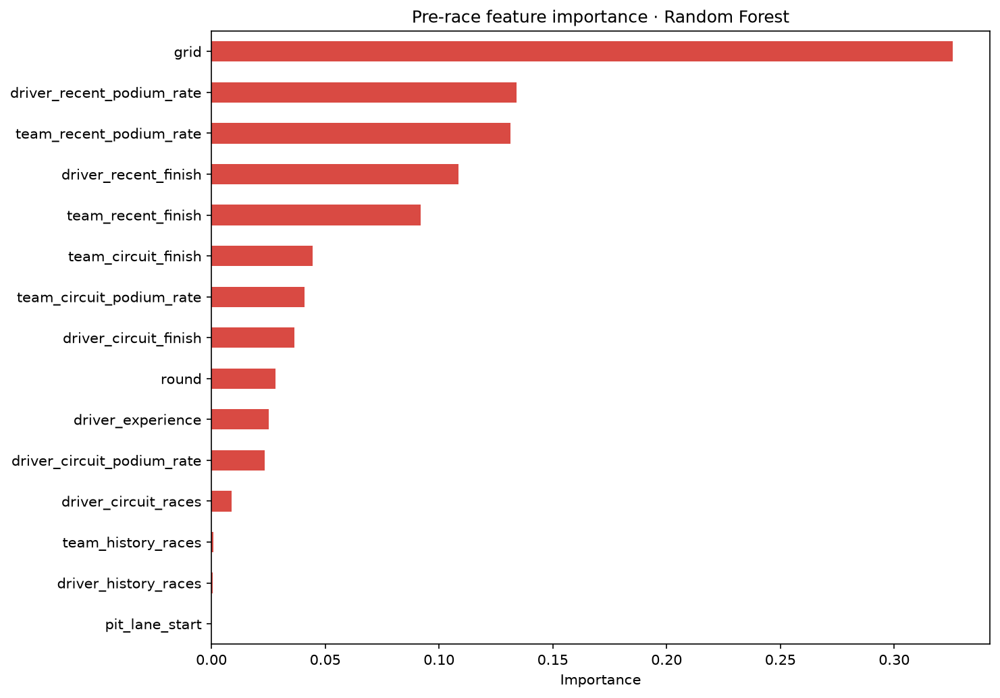

# 🏁 F1 Podium Prediction with Machine Learning

An end-to-end machine learning project that predicts whether a Formula 1 driver will
finish a race **on the podium (top 3)** — from raw historical race data, through
training and comparison of three models, to a live interactive dashboard.

> **Result:** ~0.90 accuracy and ~0.96 ROC-AUC across all models. Best F1 (podium class):
> **XGBoost — 0.7212**. Best precision: **Gradient Boosting — 0.700** (accuracy 0.9140).

---

## 📌 Problem Statement

Predict, for any F1 race entry, whether the driver finishes in **position 1–3**.

- Framed as **binary classification**: `top3 = 1` (podium) vs `top3 = 0` (position 4+ or DNF).
- Hard because podiums are rare — only **14.9%** of the 8,252 clean race entries in the
  dataset — making this a heavily **imbalanced classification** problem.
- Metric focus is therefore the **F1-score of the podium class**, not raw accuracy.

## 📊 Dataset

Built on the [Ergast Formula 1 database](https://ergast.com/mdb/) (1950–2024),
supplemented with a custom 2025 grid/results file for live predictions.

| File | Rows | Role |
|---|---:|---|
| `data/results.csv` | 26,759 | Target + core features |
| `data/races.csv` | 1,125 | Season / circuit context |
| `data/drivers.csv` | 861 | Driver nationality |
| `data/constructors.csv` | 212 | Team identity |
| `data/qualifying.csv` | 10,494 | Grid source (future use) |
| `data/lap_times.csv` | 589,081 | Telemetry-level detail |
| `data/f1_2025_grid.csv` | 20 | 2025 drivers & teams (front end) |
| `data/f1_2025_results.csv` | 66 | 2025 race results |

> The large `data/lap_times.csv` is not committed — download the full dataset from
> [Kaggle: Formula 1 World Championship (1950–2020+)](https://www.kaggle.com/datasets/rohanrao/formula-1-world-championship-2007-2020)
> or [ergast.com/mdb](https://ergast.com/mdb/) and place the CSVs in `data/`.

## ⚙️ Pipeline

```
data/*.csv ─► merge & clean ─► features + top3 target ─► 80/20 stratified split
   ─► train RF / GradientBoosting / XGBoost ─► evaluate & compare
   ─► save joblib models + encoders (models/) ─► Streamlit dashboard (app.py)
```

**Features (9):** `grid`, `laps`, `fastestLap`, `rank`, `fastestLapSpeed`, `year`,
`statusId`, plus label-encoded `nationality` and `constructor`.
**Target:** `top3` = finishing position ≤ 3.
**Split:** 80/20 stratified → 6,601 train / 1,651 test samples.

## 🤖 Models & Results

| Model | Hyperparameters | Accuracy | Precision | Recall | F1 (podium) | ROC-AUC | Train |
|---|---|---:|---:|---:|---:|---:|---:|
| **XGBoost** ★ | 200 est., depth 6, lr 0.1, `scale_pos_weight` | 0.8988 | 0.6119 | **0.8780** | **0.7212** | 0.9557 | 2.06 s |
| Gradient Boosting | 200 est., depth 5, lr 0.1 | **0.9140** | **0.7000** | 0.7398 | 0.7194 | **0.9570** | 1.75 s |
| Random Forest | 200 trees, depth 15, `class_weight='balanced'` | 0.8964 | 0.6068 | 0.8659 | 0.7136 | 0.9568 | **0.23 s** |

All three models share identical features and split, so the comparison is like-for-like.
Feature importance confirms F1 domain knowledge: **grid position** dominates, followed by
**constructor identity** — the car matters more than the driver's passport.



## 🖥️ Pitwall dashboard (Streamlit)

```bash
python -m streamlit run app.py        # → http://localhost:8501
```

A dark motorsport workspace with four analysis views:

- **Driver analysis** — compare all three model scores and sweep every starting
  position while holding the remaining assumptions fixed.
- **Grid simulator** — edit all starting slots, rank the field, and download a CSV
  with every model score, selected scoring method, threshold and scenario inputs.
  Duplicate, missing and fractional starting slots block scoring until corrected.
- **Head to head** — compare two drivers at independently chosen grid positions.
  This compares podium membership scores, not the chance one driver beats another.
- **Model evidence** — inspect metrics from your local training run, feature
  importance from the loaded artifacts, and the limitations of the models.

All views share a model selector (equal-weight model average by default), a
classification threshold, and race assumptions. Model spread measures disagreement,
not calibrated uncertainty. Grid scores are independent and need not sum to three;
score rank is not a predicted race finishing position.

Models and encoders are cached. Historical team aliases are disclosed; unknown
teams and nationalities stop inference rather than silently borrowing an unrelated
label. Driver identity itself is not a feature. The roster is the bundled **2025
snapshot**, even when you change the hypothetical scenario season. Missing models
show setup instructions instead of a traceback.

Training writes `models/metrics.json` alongside the model artifacts. The dashboard
reads this report rather than displaying hard-coded benchmark claims. The numbers
in the table above are the original project benchmarks and may differ by library
version. Metrics still reflect the original retrospective, random-holdout task.

## 🚀 Getting Started

```bash
# 1. Create a virtual environment
python -m venv venv
source venv/bin/activate              # Linux / macOS
# Windows: .\venv\Scripts\activate

# 2. Install dependencies
pip install -r requirements.txt

# 3. (Optional) Download full Ergast CSVs into data/ (incl. lap_times.csv)

# 4. Train the models (saves to models/)
python train_models.py

# 5. Launch the dashboard
python -m streamlit run app.py
```

## 📁 Project Structure

```
ml_f1_predictor/
├── data/                  # Ergast CSVs + 2025 grid/results
├── models/                # Trained .joblib models + encoders (gitignored, regenerable)
├── preprocess.py          # Early exploratory pipeline + feature-importance plot
├── train_models.py        # Full training pipeline → models/ (canonical)
├── compare_models.py      # Quick one-off model comparison
├── app.py                 # Pitwall Streamlit dashboard
├── prediction.py          # Shared batch inference and grid validation
├── tests/                 # Inference and Streamlit interaction checks
├── DESIGN.md              # Visual system and interface decisions
├── .streamlit/config.toml # Native dark theme
├── build_ppt.py           # Generates F1_Podium_Prediction.pptx (project deck)
└── requirements.txt
```

## ⚠️ Limitations

- **Data leakage:** `laps`, `fastestLap`, `rank`, `fastestLapSpeed` and `statusId` are
  only known *after* a race — the current model is explanatory/retrospective, not a
  true pre-race forecast.
- Random (not time-based) split — no true out-of-sample season validation yet.
- No qualifying times, weather, tyre or telemetry features.
- Static label encoders — new teams/drivers require retraining.

## 🗺️ Roadmap

- [ ] Leakage-free retrain using pre-race features (rolling driver/constructor form, circuit history)
- [ ] Time-based backtesting: train ≤ year *X*, predict season *X+1*
- [x] Head-to-head podium score comparison
- [ ] Race-winner prediction mode
- [ ] Automated ingestion of new 2025 results + scheduled retraining
- [x] Grid-position sensitivity, model comparison charts and scenario CSV export
- [ ] Probability calibration

## 🛠️ Tech Stack

Python 3.12 · pandas · scikit-learn · XGBoost · joblib · Streamlit · matplotlib/seaborn · python-pptx

## Verification

After training the models:

```bash
python -m unittest discover -s tests -v
```

Inference tests cover grid validation, historical team aliases, unknown labels,
feature ordering and shared model scoring. Streamlit tests exercise changing the
model, race assumptions, driver comparison and invalid grid handling.
